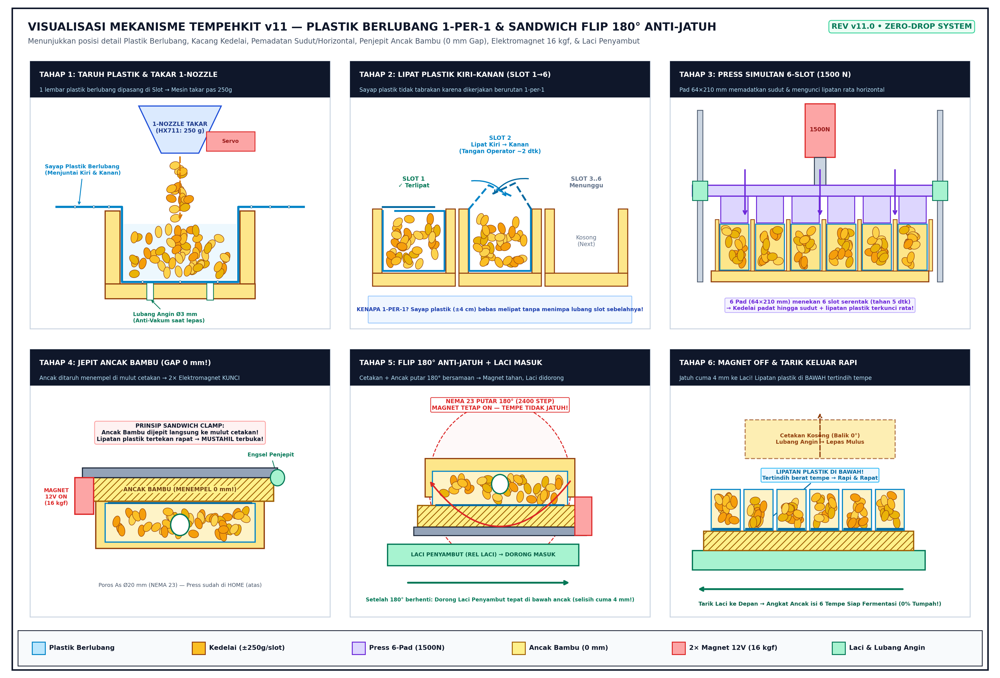
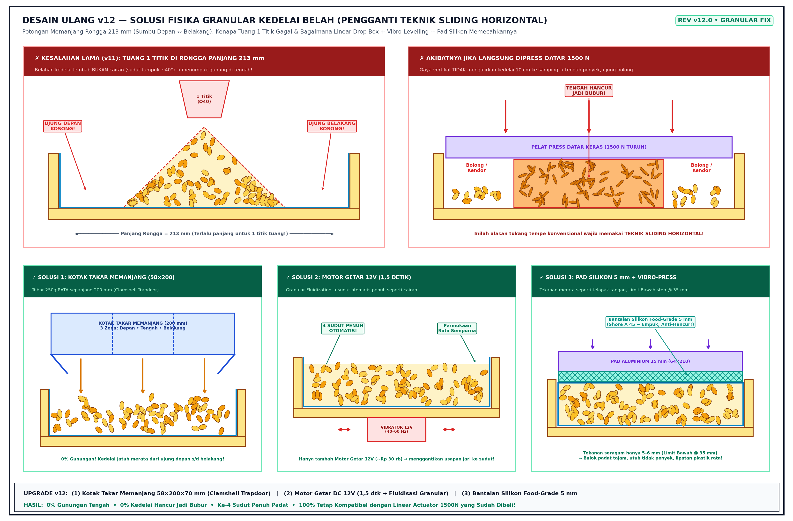
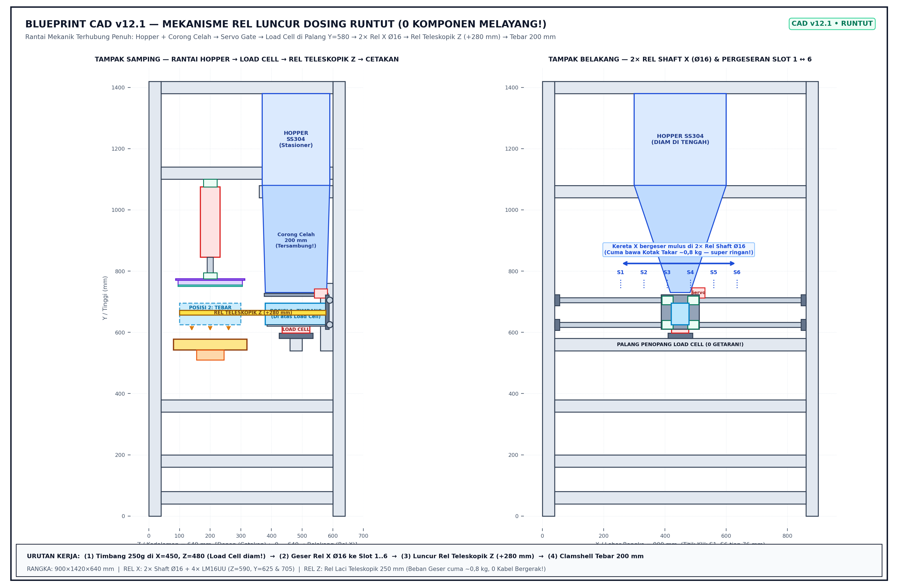
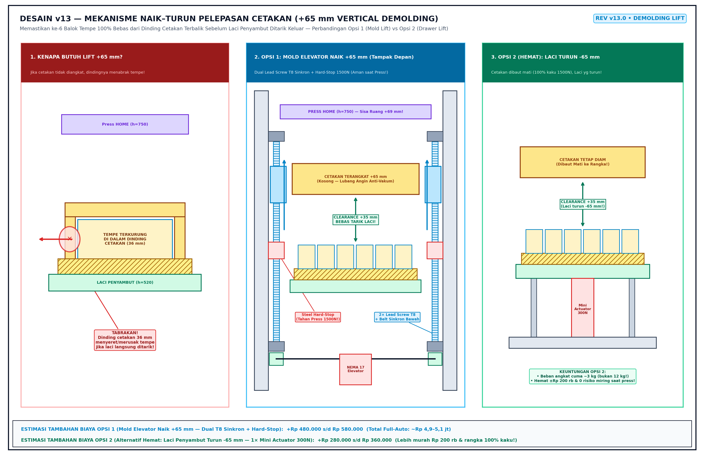

# 🫘 TempehKit v13 — Mesin Pencetak Tempe Otomatis berbasis IoT
## Arsitektur Final v13 (Opsi 2): 6-Slot • Tebar Rata 200 mm • Pad Silikon • Flip 180° • Laci Elevator 75 mm

[](https://www.espressif.com/)
[](https://www.arduino.cc/)
[](cad/README_CAD.md)
[](docs/panduan_uji_hardware.md)
[](LICENSE)

**TempehKit v13** adalah mesin pencetak tempe balok semi/full-otomatis berbasis **ESP32 IoT** yang dirancang mengikuti **fisika nyata pencetakan tempe tradisional plastik berlubang (1-per-1)** di atas ancak bambu.

Berbeda dari desain awal (v9), arsitektur final **v13 (Opsi 2)** menyelesaikan seluruh kendala lapangan:
1. **Anti-Gunungan Kedelai Belah:** Menggunakan **Kotak Takar Memanjang (`58 × 200 × 70 mm`, Clamshell Trapdoor 3 zona)** yang meluncur di atas **Rel X (`Ø16 mm`) + Rel Teleskopik Z (`30 cm`)** sehingga menebar 250 g kedelai **rata sepanjang 200 mm** (bukan tuang 1 titik).
2. **Pengganti Teknik *Sliding Horizontal*:** Kombinasi **Motor Getar DC 12V (*Vibro-Levelling* 1,5 dtk)** untuk mengisi penuh ke-4 sudut rongga + **6 Pad Penekan 2-Lapis (Aluminium 15 mm + Bantalan Silikon Food-Grade 5 mm)** dengan **Linear Actuator 12V 1500 N** — padat tajam tanpa menghancurkan kedelai menjadi bubur.
3. **Flip 180° Anti-Jatuh (*Zero-Drop Sandwich Clamp*):** Ancak bambu diselipkan horizontal ke **Rel Selip L-Channel** tepat menempel (`0 mm`) di mulut cetakan dan dikunci **2× Elektromagnet 12V (16 kgf)** lalu diputar **180° oleh NEMA 23 + Belt HTD3M-384 (1:3)**.
4. **Pelepasan Vertikal 0% Gesek (*Laci Elevator 75 mm — Opsi 2*):** Cetakan + NEMA 23 **dibaut mati ke rangka** (100% kaku menahan 1500 N), sementara **Laci Penyambut** digerakkan naik–turun `75 mm` oleh **1× Mini Linear Actuator 12V 300N + 2× Guide Rod Ø10 mm** — menangkap ancak (`gap 0–4 mm`), melepas magnet, lalu turun vertikal `-75 mm` membuka ruang bebas `+45 mm` sebelum ditarik keluar.

---

## 🖥️ Simulasi CAD 3D Interaktif & Blueprint Visual (v13)

> **Buka Simulasi 3D Interaktif (1 File HTML Mandiri — cukup klik ganda di Chrome/Edge):**
> 👉 **[`cad/viewer_3d_v13.html`](cad/viewer_3d_v13.html)** — Putar 360°, zoom, dan tonton animasi runtut 7 tahap dari Dosing → Getar → Press Silikon → Flip 180° → Laci Elevator Turun `-75 mm`!

| 1. Visualisasi Proses 6-Tahap (Plastik & Flip Anti-Jatuh) | 2. Solusi Fisika Granular (Linear Drop + Vibrator + Silikon) |
| :---: | :---: |
|  |  |

| 3. Mekanisme Rel Luncur Dosing Runtut (X-Z) | 4. Desain Laci Elevator Pelepasan Vertikal (Opsi 2) |
| :---: | :---: |
|  |  |

---

## 📌 Dokumen Acuan Utama Proyek (v13 Final)

1. 🛒 **[`docs/bom_belanja.md`](docs/bom_belanja.md) — Daftar Belanja Lengkap (v13 Opsi 2) & Daftar Potong Besi Hollow**
   * Rincian RAB lanjutan Full Otomatis (~Rp 4,75 jt) vs Semi-Otomatis (~Rp 4,17 jt) + ukuran potong hollow 40×40 mm siap bawa ke bengkel las.
2. 📐 **[`docs/dimensi_mekanik.md`](docs/dimensi_mekanik.md) — Spesifikasi Dimensi Final v13 (Zero-Collision)**
   * Ukuran rangka terpadu `900 × 1420 × 640 mm`, cetakan 6-slot pitch eksak `76 mm`, Stub-Axle luar, clearance flip `+55 mm`, dan Laci Elevator `75 mm`.
3. 🔍 **[`docs/evaluasi_dan_desain_ulang_v10.md`](docs/evaluasi_dan_desain_ulang_v10.md) — Catatan Audit Bug v9 → v10+**
   * Rekam jejak teknis perbaikan seluruh kesalahan mekanik, CAD, dan firmware.
4. 🚀 **[`docs/PROJECT_EXECUTION_PLAN.md`](docs/PROJECT_EXECUTION_PLAN.md) — Roadmap Eksekusi Sprint 0–5**
   * Status progres aktual (*Sprint 2 Bench Test 100% LULUS* → lanjut fabrikasi rangka & integrasi penuh).
5. 🔬 **[`docs/panduan_uji_hardware.md`](docs/panduan_uji_hardware.md) — Panduan Bench Test 7 Modul Elektronik**
   * Panduan pengujian meja ESP32, HX711, Servo, L298N + Linear Actuator, NEMA 23 + TB6600, dan Elektromagnet 12V.
6. 🧊 **[`cad/README_CAD.md`](cad/README_CAD.md) — Panduan File CAD 3D & AutoCAD DXF R2010**

---

## ⚙️ Spesifikasi Teknis Mesin (v13 Opsi 2 Final)

| Parameter | Spesifikasi Final v13 |
| :--- | :--- |
| **Kapasitas Cetak** | **6 Slot tempe per siklus** (plastik berlubang 1-per-1, ±250 g/slot) |
| **Dimensi Rongga Cetakan** | `213 × 66 × 36 mm` • Sekat `10 mm` • **Pitch Eksak `76.0 mm`** • Lubang angin `Ø3 mm` |
| **Dimensi Cetakan (SS304 1.5 mm)** | `591 × 240 × 36 mm` + **Stub-Axle Ø20 mm luar** (rongga bersih) + Rel Selip L-Channel |
| **Dimensi Rangka Utama** | `900 (L) × 1420 (T) × 640 (D) mm` (Besi Hollow `40 × 40 × 2.0 mm`) |
| **Sistem Dosing & Timbang** | Hopper Trapesium SS304 + Servo Gate MG996R + **Load Cell 20 kg Stasioner** (0 getaran) + **Kotak Takar Memanjang `58×200×70 mm`** di Rel X (`Ø16 mm`) & Rel Teleskopik Z (`30 cm`) |
| **Perataan Sudut & Press** | **Motor Getar DC 12V** (`1,5 dtk`) + **Linear Actuator 12V 1500N (Stroke 200 mm)** + Pelat Gantry `750×225 mm` + **6 Pad `64×210 mm` berlapis Silikon Food-Grade 5 mm** + 2× Linear Guide `Ø12 mm` (`Z=265`) |
| **Flip 180° & Pelepasan Tempe** | **NEMA 23 (23HS5628)** + TB6600 + **Belt HTD3M-384 (20T→60T, 1:3, 2400 step)** + 2× Elektromagnet P25/20 (`16 kgf`) + **Laci Elevator 75 mm** (`Mini Actuator 12V 300N` + 2× Guide `Ø10 mm`) |
| **Antarmuka & IoT** | Web Dashboard Wi-Fi lokal ESP32 (`SPIFFS`) + Serial Bench Console + Tombol START/STOP + LED + Buzzer |
| **Catu Daya** | PSU Switching `12V 10A` + LM2596 (`5.0V` ESP32/Sensor) + XL4015 `5A` (khusus Servo multi-channel) |

---

## 📁 Struktur Repositori

```text
tempehkit/
├── cad/                                   # CAD 3D Interaktif, Blueprint 200 DPI, & DXF R2010
│   ├── viewer_3d_v13.html                 # ★ Simulasi CAD 3D Interaktif Final (Opsi 2)
│   ├── v13_desain_elevator_demolding.png  # Blueprint perbandingan & desain Laci Elevator 75 mm
│   ├── v12_solusi_granular_dan_press.png  # Diagram solusi granular anti-gunungan & pad silikon
│   ├── v12_mekanisme_rel_dosing.png       # Blueprint mekanisme rel luncur dosing X-Z runtut
│   ├── v12_dosing_dan_press.dxf           # DXF Kotak Takar 58×200, Pad Silikon & Vibrator
│   ├── v11_visualisasi_proses_tempe.png   # Storyboard 6 tahap plastik berlubang & flip anti-jatuh
│   ├── v10_cetakan_6slot.{dxf,png}        # DXF Laser Cut 1:1 & Blueprint Cetakan 6-Slot SS304
│   ├── v10_pelat_penekan.{dxf,png}        # DXF & Blueprint Pelat Gantry + 6 Pad 64×210 mm
│   ├── generate_v10..v13.py               # Script Python generator CAD parametrik
│   └── README_CAD.md                      # Panduan penggunaan berkas CAD
├── docs/                                  # Dokumentasi teknis, RAB & rencana eksekusi
│   ├── bom_belanja.md                     # 🛒 RAB Final v13 (Opsi 2) + Daftar Potong Hollow
│   ├── dimensi_mekanik.md                 # 📐 Spesifikasi dimensi lengkap bengkel las
│   ├── evaluasi_dan_desain_ulang_v10.md   # 🔍 Evaluasi bug v9 & catatan perbaikan
│   ├── PROJECT_EXECUTION_PLAN.md          # 🚀 Progress Sprint 0–5
│   └── panduan_uji_hardware.md            # 🔬 Panduan uji meja 7 modul (100% LULUS)
├── firmware/                              # Kode ESP32 produksi & modular unit test
│   ├── mesin_tempe/
│   │   ├── mesin_tempe.ino                # Firmware FSM v10 (bug-fixed + Servo/Relay + Console)
│   │   ├── libraries.txt                  # Daftar library Arduino IDE
│   │   └── data/index.html                # Web Dashboard Wi-Fi (SPIFFS)
│   └── tests/                             # 01–08 Modular Hardware Bench Tests
└── README.md
```

---

## 🔌 Pemetaan Pin ESP32 (Inti — Teruji Bench Test)

```text
GPIO  4  ──► HX711 DOUT (Data Load Cell 20 kg)
GPIO  5  ──► HX711 SCK  (Clock Load Cell 20 kg)
GPIO 12  ──► TB6600 PUL+ (STEP NEMA 23 Flip 180°)
GPIO 14  ──► TB6600 DIR+ (DIR NEMA 23)
GPIO 13  ──► Relay Elektromagnet 12V (Kunci Palang Ancak)
GPIO 25  ──► L298N IN1 (Linear Actuator Press TURUN)
GPIO 26  ──► L298N IN2 (Linear Actuator Press NAIK)
GPIO 27  ──► Servo Gate Hopper MG996R (PWM 0°–90°) / Relay Gate
GPIO 32  ──► Limit Switch Press ATAS (INPUT_PULLUP, aktif LOW)
GPIO 33  ──► Limit Switch Press BAWAH (INPUT_PULLUP, aktif LOW)
GPIO 34  ──► Tombol Fisik START (INPUT + ext pull-up 10kΩ)
GPIO 35  ──► Tombol Fisik STOP / EMERGENCY (INPUT + ext pull-up 10kΩ)
GPIO  2  ──► LED Hijau (OK / RUN)
GPIO 15  ──► LED Merah (ALARM)
GPIO 23  ──► Buzzer Aktif 5V
Spare    ──► GPIO 16, 17, 18, 19, 21, 22 (I2C PCA9685 / Mini Actuator Laci / Vibrator / NEMA 17)
             GPIO 36, 39 (Input-only: Limit Switch Home X/Z & Laci)
```

---

## 💻 Library Arduino IDE

1. **`AccelStepper`** by Mike McCauley
2. **`HX711`** by bogde (v0.7.5+)
3. **`ArduinoJson`** by Benoit Blanchon (v6.x)
4. **`ESP32Servo`** by Kevin Harrington (untuk Servo Gate MG996R)

---

## 📄 Lisensi

Proyek ini dilisensikan di bawah **MIT License** — bebas digunakan dan dikembangkan untuk otomasi industri tempe UKM.
